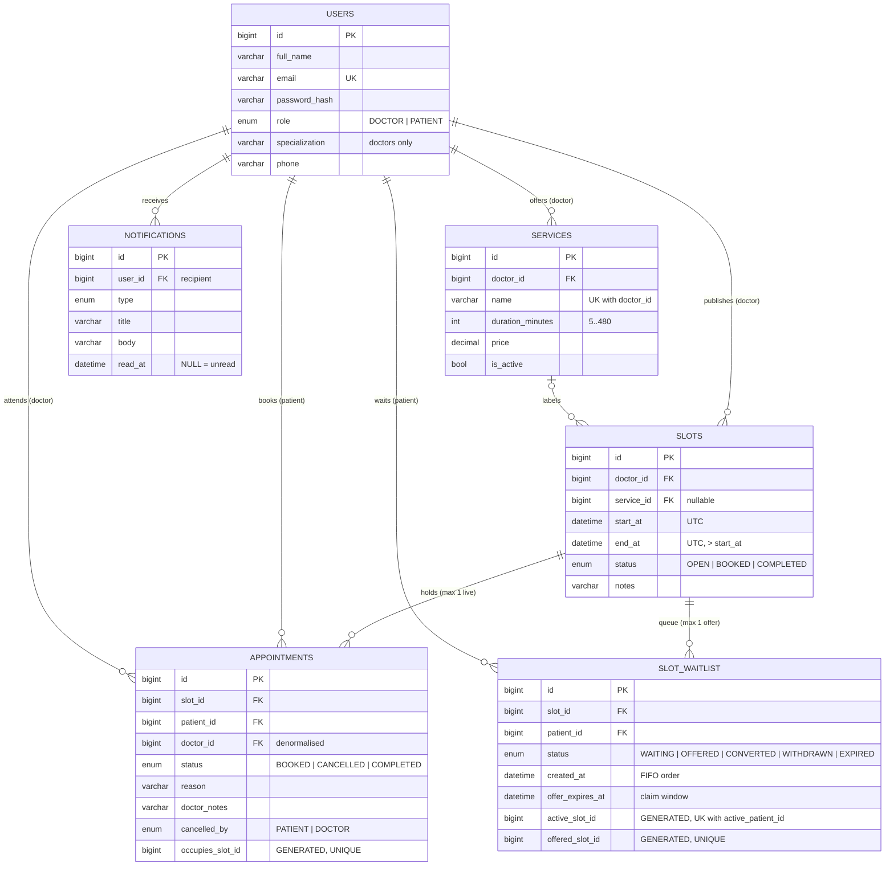
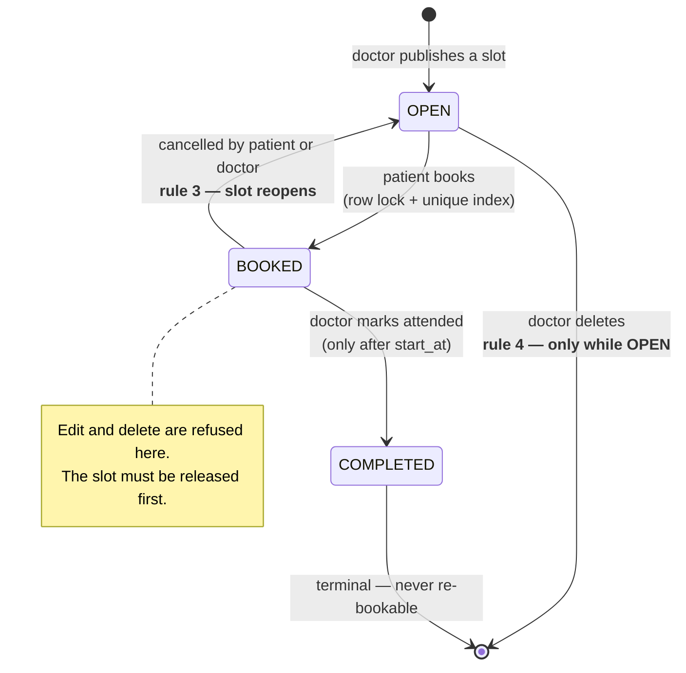

# Design notes

The reasoning behind the implementation: the data model, the three-layer defence against
double-booking, the waiting queue, and the authorization boundaries.

Every behavioural claim below was verified against a real MySQL 8.0 server before being
written down — including the concurrency claims, which were exercised with 12 real OS
threads racing on a single slot. Where a claim names a test (e.g. `test_concurrency.py`),
that is the check that proved it; the test suite itself is kept out of this repository to
keep the submission to the application code.

---

## 1. Data model



### Two deliberate choices

**`appointments.doctor_id` is denormalised** from `slots.doctor_id`. It could be reached
by a join, but every doctor-side authorization check filters on it, and copying it at
booking time means a patient's history stays readable even if the doctor later reworks
their schedule.

**A slot accumulates one appointment row per booking attempt over its lifetime.**
Cancelled rows are never deleted — they are the audit trail of who held the slot and why
they gave it up. Only one row is ever *live*.

### The slot ↔ appointment invariant

| `slots.status` | Live appointment on it |
|---|---|
| `OPEN` | none |
| `BOOKED` | exactly one, `status = BOOKED` |
| `COMPLETED` | exactly one, `status = COMPLETED` |

`slots.status` is a denormalised cache of that fact. It exists so browsing open slots is
one indexed scan (`ix_slots_open_browse`) instead of a `NOT EXISTS` subquery per row. It
is only ever written in the same transaction as the appointment change, so it cannot
drift. `test_schema_drift.py` and every concurrency test assert the invariant directly
against the database.

---

## 2. State machine



A completed slot deliberately does **not** return to `OPEN`. The consultation happened;
that window is spent. Only a cancellation frees a slot.

---

## 3. Preventing double-booking

This is the heart of the task, so it gets three independent layers.

### The race we are defending against

Two patients click *Book* on the same slot at the same instant. The naive
implementation — read the slot, check `status == 'OPEN'`, insert an appointment — has a
window between the check and the insert where both requests believe the slot is free:

```
        Transaction A                    Transaction B
  t1    SELECT slot → OPEN
  t2                                     SELECT slot → OPEN     ← both see OPEN
  t3    INSERT appointment
  t4                                     INSERT appointment     ← two live bookings
  t5    UPDATE slot → BOOKED
  t6                                     UPDATE slot → BOOKED
```

### Layer 1 — pessimistic row lock

```python
slot = db.execute(
    select(Slot).where(Slot.id == slot_id).with_for_update()
).scalar_one_or_none()
```

`SELECT … FOR UPDATE` takes an exclusive InnoDB row lock. B now blocks at `t2` until A
commits or rolls back, so the interleaving above cannot occur:

```
        Transaction A                    Transaction B
  t1    SELECT … FOR UPDATE → OPEN
  t2                                     SELECT … FOR UPDATE  ⟵ BLOCKS
  t3    INSERT appointment
  t4    UPDATE slot → BOOKED
  t5    COMMIT  (lock released)
  t6                                     … unblocks, reads BOOKED → 409
```

`db.get()` is deliberately **not** used here: it can return a stale copy from the
session's identity map without going to the database at all.

### Layer 2 — re-check status under the lock

```python
if slot.status is not SlotStatus.OPEN:
    raise app_error("SLOT_NOT_OPEN")
```

This is what B hits at `t6`. It works because **InnoDB locking reads always see the
latest committed row, not the transaction's snapshot** — even under `REPEATABLE READ`,
which is MySQL's default and what this project runs on. A plain `SELECT` here would read
B's older snapshot and still see `OPEN`; `FOR UPDATE` is what makes the re-check
meaningful.

### Layer 3 — the database refuses it outright

```sql
occupies_slot_id BIGINT UNSIGNED
  GENERATED ALWAYS AS (IF(status IN ('BOOKED','COMPLETED'), slot_id, NULL)) VIRTUAL,
UNIQUE KEY uq_appointments_occupied_slot (occupies_slot_id)
```

`occupies_slot_id` equals `slot_id` while the appointment is live and becomes `NULL` once
cancelled. A `UNIQUE` index ignores `NULL`s, so this expresses exactly:

> at most **one** live appointment per slot — and unlimited cancelled ones.

**Why this layer is not redundant.** `SELECT … FOR UPDATE` on a row that does not exist
takes no lock at all, and application checks cannot span processes, a second API replica,
a background job, or someone at a `mysql` prompt. The unique index is enforced by the
storage engine, so it holds regardless of what the application believes. If the service
layer is ever refactored wrongly, this is what turns a silent data corruption into a
loud `409`.

The application catches it precisely rather than blaming the user for a generic error:

```python
except IntegrityError as exc:
    db.rollback()
    if OCCUPIED_SLOT_CONSTRAINT in str(exc.orig):
        raise app_error("SLOT_ALREADY_BOOKED") from exc
    raise
```

### Why not `UNIQUE (slot_id)`?

Because rule 3 requires a cancelled slot to be re-bookable. A plain unique key on
`slot_id` would reject the *second* booking of a slot forever, even after the first was
cancelled. The alternatives:

| Approach | Verdict |
|---|---|
| `UNIQUE (slot_id)` | ✗ Breaks rule 3 — a slot could never be re-booked. |
| `UNIQUE (slot_id, status)` | ✗ Allows one `BOOKED` **and** one `COMPLETED` row on the same slot, and still blocks a second cancellation. |
| Partial index `WHERE status='BOOKED'` | ✗ MySQL has no partial/filtered indexes (Postgres does). |
| Delete the row on cancellation | ✗ Destroys the audit trail; a no-show becomes invisible. |
| **`UNIQUE` on a generated column** | ✓ Exactly the right predicate, enforced by the engine, history preserved. |

### `VIRTUAL`, not `STORED` — found by testing, not by guessing

The first version of this schema used `STORED`. MySQL refused to create the table:

```
ERROR 1215 (HY000): Cannot add foreign key constraint
```

MySQL forbids `ON DELETE CASCADE` / `SET NULL` / `SET DEFAULT` on the **base column** of
a *stored* generated column — and `slot_id` is both the base column of
`occupies_slot_id` and the `ON DELETE CASCADE` foreign key to `slots`. `VIRTUAL` carries
no such restriction, and InnoDB fully supports a `UNIQUE` secondary index on a virtual
column, so the guarantee is identical.

Verified directly against MySQL 8.0.44:

| Check | Result |
|---|---|
| `VIRTUAL` + `UNIQUE` + `ON DELETE CASCADE` | table creates cleanly (`STORED` does not) |
| second `BOOKED` row on one slot | `ERROR 1062 Duplicate entry '1' for key 'appointments.uq_appointments_occupied_slot'` |
| cancel, then re-book | succeeds — rule 3 |
| re-book a `COMPLETED` slot | rejected — stays unbookable |
| delete a slot | appointments cascade away |

`test_schema_drift.py` asserts `information_schema` still reports
`extra = 'VIRTUAL GENERATED'`, so a future change back to `STORED` fails the suite
instead of failing at deploy time.

### Proof it actually works

`test_concurrency.py` drives a real uvicorn server over real sockets with 12 OS threads,
released together by a `threading.Barrier` so the requests genuinely collide:

```
12 patients POST /appointments on the same slot
  → exactly 1  × 201 Created
  → exactly 11 × 409 (SLOT_ALREADY_BOOKED or SLOT_NOT_OPEN)
  → SELECT COUNT(*) FROM appointments WHERE occupies_slot_id = ? … = 1
  → slots.status = 'BOOKED'
```

Two further tests: 8 rounds of *race → cancel → race again* (the invariant holds every
round, and the audit trail ends with exactly 8 rows), and 6 patients booking 6 **different**
slots concurrently, all succeeding — proving the locking does not serialize unrelated
slots.

`TestClient` is not used for these: it funnels everything through one anyio portal, so it
cannot produce a real race.

### Deadlock safety

Booking, cancelling and completing each touch both `slots` and `appointments`. Two
transactions taking those locks in opposite orders would deadlock. So there is **one
global lock order, documented in `app/services/__init__.py` and obeyed everywhere:**

```
slots  →  appointments
```

`cancel_appointment` and `complete_appointment` are given an appointment id, not a slot
id, so they first read `slot_id` with an **unlocked** query, then take the slot lock, then
the appointment lock. That is safe because `appointments.slot_id` is immutable once
written; the re-check after locking catches anything that changed meanwhile.

---

## 4. The waiting queue and notifications

Losing a booking race should not be a dead end. The loser joins a **FIFO queue** for that
slot; when the slot is released, the patient at the head is notified and gets an
**exclusive claim window** on it.

### What happens to the loser of a race

`book_appointment` refuses with `SLOT_NOT_OPEN`, `SLOT_ALREADY_BOOKED` or `SLOT_RESERVED`,
and on that path enrols the caller in the queue. The `409` body carries their place, so
the UI can say something useful instead of "failed":

```json
{ "error": {
    "code": "SLOT_NOT_OPEN",
    "message": "That slot is no longer open for booking. You are now number 2 on its waiting list and will be notified if it becomes free.",
    "details": { "waitlist_id": 7, "slot_id": 28, "position": 2, "queue_length": 2 } } }
```

Enrolment runs in a **separate transaction, after the failed booking has rolled back**.
Doing it inline would mean the rollback that undoes the booking also undoes the queue
entry.

### Handing the slot on when it is released

`cancel_appointment` reopens the slot and calls `settle_offers()` **in the same
transaction**. So the slot going back to `OPEN` and the next patient being notified commit
together — nobody can be told about a slot that did not actually free up.

```
patient/doctor cancels
   ├─ appointment.status = CANCELLED
   ├─ slot.status        = OPEN            ← rule 3
   ├─ notify the other party              (APPOINTMENT_CANCELLED)
   └─ settle_offers(slot)
        └─ head of queue → OFFERED
             offer_expires_at = min(now + 15 min, slot.start_at)
             notify that patient           (SLOT_AVAILABLE)
   COMMIT
```

While the claim window is live, **any other patient booking that slot is refused** with
`409 SLOT_RESERVED` — and joins the queue behind. So the queue is genuinely fair: being
first in line is worth something.

### Queue integrity is enforced by the database, not by the application

The same technique as rule 1 — project the predicate into a generated column, index it
`UNIQUE`, and let `NULL`s exempt inactive rows:

```sql
active_slot_id    GENERATED ALWAYS AS (IF(status IN ('WAITING','OFFERED'), slot_id,    NULL)) VIRTUAL,
active_patient_id GENERATED ALWAYS AS (IF(status IN ('WAITING','OFFERED'), patient_id, NULL)) VIRTUAL,
offered_slot_id   GENERATED ALWAYS AS (IF(status = 'OFFERED',              slot_id,    NULL)) VIRTUAL,

UNIQUE KEY uq_waitlist_active_pair       (active_slot_id, active_patient_id),
UNIQUE KEY uq_waitlist_one_offer_per_slot (offered_slot_id)
```

| Index | Guarantees | Verified |
|---|---|---|
| `uq_waitlist_active_pair` | a patient cannot hold two places in one queue | duplicate insert → `1062` |
| `uq_waitlist_one_offer_per_slot` | **at most one live offer per slot, ever** | second `OFFERED` → `1062` |

The second is the one that matters. "Two patients were both told the slot is theirs"
becomes impossible in the storage engine rather than merely unlikely in the application.

A MySQL `UNIQUE` index skips any row where an indexed column is `NULL`, which is exactly
why cancelled, expired and converted rows can pile up without ever colliding.

### Why the slot lock is enough

Every function that mutates a queue requires the caller to already hold that slot's
`SELECT … FOR UPDATE` row lock. That single lock is the serialization point for
everything about a slot — its status, its appointments *and* its queue. Because no code
path touches a queue without first locking the slot, **the queue needs no lock of its
own**, and the global lock order stays `slots → appointments` with no third entry to get
wrong.

### Fair ordering

Position is `ORDER BY created_at, id`. `DATETIME` has one-second granularity, so two
patients who joined in the same second would tie; the auto-increment `id` breaks it
deterministically. Without that tiebreak, positions could flap between reads and two
patients could both believe they were next.

### Claim windows expire without a scheduler in the way

A lapsed window is settled from two directions:

1. **Lazily** — the next booking attempt on that slot calls `settle_offers()` first,
   which expires the stale offer and promotes the next patient.
2. **A background sweep** — an asyncio task in the app lifespan (`waitlist_sweep_seconds`,
   default 60) does the same for queues nobody is actively trying to book.

The sweep is what makes the feature actually work: without it, the patient after a
no-show would wait indefinitely for a notification that only fires when some third party
happens to attempt a booking. It is disabled in tests so it cannot mutate rows underneath
an assertion.

### Notifications

| Event | Recipient | Type |
|---|---|---|
| Patient books a slot | **the doctor** | `APPOINTMENT_BOOKED` |
| Either party cancels | the other party | `APPOINTMENT_CANCELLED` |
| Doctor marks completed | the patient | `APPOINTMENT_COMPLETED` |
| Slot released and you are first in line | **that patient** | `SLOT_AVAILABLE` |
| You joined a queue | that patient | `WAITLIST_JOINED` |
| Your claim window lapsed | that patient | `WAITLIST_MISSED` |
| Doctor deleted or moved the slot | everyone queued | `SLOT_WITHDRAWN` |

`notify()` only ever calls `db.add()` — never `commit()`. The caller commits it with the
event, so **a notification can never announce something that was rolled back.**

Delivery to the browser is polling (`GET /notifications/unread-count` every 20 s), not
WebSockets or SSE. At this cadence it is a single indexed count query, and it keeps the
deployment story to one stateless process. SSE would be the upgrade path if the
notification volume ever justified it.

One honest wart: notification bodies are plain strings containing an absolute time,
labelled `UTC`. Because the text is baked in at write time there is no way to re-render it
in the reader's timezone later. Storing a structured payload and formatting client-side
would fix it.

---

## 5. Time and conflict logic

### One timezone rule, in one module

MySQL `DATETIME` columns hold **naive UTC**. Nothing else, anywhere.
`app/core/timeutil.py` owns every conversion:

- input must be timezone-aware — an ISO string with no offset is **rejected**
  (`422 VALIDATION_ERROR`), never guessed. Guessing is how bookings land an hour out
  across a DST boundary.
- output is always `…Z`.
- `utc_now_naive()` is the only "now", so comparisons against DB columns need no coercion.
- `datetime.now(timezone.utc)`, never the deprecated `datetime.utcnow()`.

The browser converts in `src/utils/datetime.js`: `toIsoUtc()` on the way out (a
`datetime-local` input is local wall clock, and `.toISOString()` normalises it),
`toLocaleString` on the way in. Bulk slot generation sends `tz_offset_minutes` so
"9am to 1pm" means the doctor's 9am, not UTC's.

### Overlap detection: half-open intervals

Slots are `[start_at, end_at)`. Two intervals overlap iff:

```
a.start < b.end  AND  a.end > b.start
```

This makes 09:00–09:30 and 09:30–10:00 **neighbours, not a collision** — without it a
doctor could not publish a contiguous working day. The identical predicate is used in
three places, so the semantics cannot diverge:

1. **Slot vs slot, per doctor** — a doctor cannot publish two overlapping slots
   (`SLOT_OVERLAP`). Editing excludes the slot itself, so a slot never conflicts with
   its own current position.
2. **Patient's own calendar** — booking is refused if the patient already holds a live
   appointment overlapping that window, *even with a different doctor*
   (`PATIENT_TIME_CONFLICT`). Adjacent appointments remain legal.
3. **Bulk generation** — candidates that collide are *skipped and reported*, not fatal, so
   extending an existing day works instead of failing wholesale.

Overlap is scoped **per doctor**: two doctors both working at 9am is normal.

### Time-based permissions

| Action | Window |
|---|---|
| Book a slot | only while `start_at` is in the future |
| Patient cancels | only before `start_at` → afterwards `CANCEL_WINDOW_CLOSED` |
| Doctor cancels | any time — that is how a no-show is recorded |
| Doctor completes | only once `start_at` has passed → otherwise `COMPLETE_TOO_EARLY` |

---

## 6. Authorization boundaries

### Two separate mechanisms

Role gates and ownership filters answer different questions, and both are needed:

| Mechanism | Question | Failure |
|---|---|---|
| `require_doctor` / `require_patient` dependency | May this *kind* of account use this endpoint at all? | `403 FORBIDDEN_ROLE` |
| `WHERE doctor_id = :me` inside every service function | Is this *particular row* yours? | `404` |

A role gate alone is not authorization: without the ownership filter, any doctor could
read any other doctor's schedule by guessing an integer.

### Why `404` and not `403` for someone else's row

`403` confirms the id exists. Given `403` for slot 41 and `404` for slot 42, an attacker
learns the shape of the table and can enumerate it one integer at a time. Returning
`404` for "exists but not yours" leaks nothing. `403` is reserved strictly for
wrong-role, which reveals nothing an attacker does not already know about their own
account.

### The role is never trusted from the token

The JWT carries `role` for convenience, but `get_current_user` re-reads the user row on
every request and all gates check the **database** value. A token forged with
`role: DOCTOR` for a patient account is useless — asserted by
`test_role_comes_from_the_database_not_the_token`.

### "A doctor cannot see other doctors' schedules" — structural, not filtered

Rather than one endpoint with a filter someone might forget, there are two disjoint read
paths:

| Endpoint | Role | Returns |
|---|---|---|
| `GET /slots/mine` | **DOCTOR** only | always `WHERE doctor_id = me` |
| `GET /slots/open` | **PATIENT** only | only `OPEN` and future, across all doctors |

There is deliberately **no** endpoint returning an arbitrary doctor's calendar. A doctor
calling `/slots/open` gets `403`: the marketplace view spans every doctor, so it is
closed to them entirely.

### Field-level minimisation

Three different projections of the `users` table, so no endpoint returns more than the
caller needs:

| Schema | Fields | Used for |
|---|---|---|
| `UserOut` | id, name, email, role, specialization, phone | only ever the account owner |
| `DoctorPublicOut` | id, name, specialization | the directory patients browse |
| `PatientPublicOut` | id, name, phone | shown to the owning doctor — they need to call the patient |

`password_hash` is on no schema at all, so it cannot leak by accident.
`test_doctor_directory_does_not_leak_contact_details` asserts the doctor's email and
phone never appear in the directory response body.

Patients browsing slots never receive appointment data, so a slot cannot reveal who
booked it. `SlotOut.appointment` is populated only for the owning doctor.

### The full matrix

`test_authorization.py` asserts every one of these:

| Actor | Action | Result |
|---|---|---|
| Patient | `POST /slots`, `/slots/bulk`, `/services` | `403` |
| Patient | `GET /slots/mine`, `/services/mine`, `/appointments/doctor` | `403` |
| Patient | complete an appointment | `403` |
| Doctor | `GET /slots/open` | `403` |
| Doctor | book an appointment | `403` |
| Doctor | `GET /appointments/mine` | `403` |
| Doctor A | read / edit / delete doctor B's slot | `404` |
| Doctor A | read / cancel / complete doctor B's appointment | `404` |
| Doctor A | read / edit / delete doctor B's service | `404` |
| Patient A | read / cancel patient B's appointment | `404` |
| Patient A | read a booked slot they do not own | `404` |
| Anyone | any endpoint with no / malformed / expired token | `401` |

---

## 7. Other decisions worth noting

**Routers stay thin.** Every router validates input, calls one service function, and
serializes the result. No `FOR UPDATE` appears in a router. This keeps the transactional
logic in one testable place instead of spread across HTTP handlers.

**One error envelope.**

```json
{ "error": { "code": "SLOT_ALREADY_BOOKED", "message": "…", "details": null } }
```

The stable machine-readable `code` is what lets the React client react *specifically* to a
lost race — a red toast saying "someone just booked this slot" plus an automatic refresh —
instead of a generic failure. A UI that cannot distinguish "you lost a race" from "the
server is broken" is a worse UI.

**`expire_on_commit=False`** on the session, so serializing a response after `commit()`
does not fire a second round of `SELECT`s. The consequence is documented where it
matters: the in-memory value of the DB-computed `occupies_slot_id` goes stale after a
status change, so it is never read in Python — it exists purely for the engine's index.

**Deleting a service is refused while a booked or completed slot references it**
(`SERVICE_IN_USE`, with a message suggesting deactivation) — deleting it would rewrite an
appointment a patient has already seen. Slots that are merely `OPEN` are fine: the FK is
`ON DELETE SET NULL`, so they just lose their label.

**bcrypt with explicit 72-byte truncation.** bcrypt ≥ 4.1 raises on longer input rather
than silently truncating, so the truncation is done deliberately and documented.
`verify_password` returns `False` rather than raising on a malformed stored hash, so a
corrupt row cannot become a `500`.

**Tests run against real MySQL, not SQLite.** SQLite has no `SELECT … FOR UPDATE`
semantics worth speaking of, no generated columns with unique indexes, and no InnoDB row
locks. Testing on it would prove nothing about the thing this project is actually about.

---

## 8. Known limitations

Honest scope boundaries rather than hidden bugs:

- **No rescheduling primitive.** Moving an appointment means cancel-then-rebook, and the
  slot is briefly open, so the patient can lose it to someone else. A proper atomic
  `reschedule` that locks both slots in id order is the fix.
- **`slots.status` is denormalised.** It is maintained transactionally and verified by
  tests, but it is still a second source of truth. The unique index on
  `occupies_slot_id`, not `slots.status`, is what actually guarantees rule 1.
- **No refresh tokens.** Access tokens last 12 hours for demo convenience; a real
  deployment wants short access tokens plus rotation.
- **No rate limiting** on login or booking.
- **Pagination is `LIMIT`/`OFFSET`**, which drifts under concurrent inserts. Fine at this
  scale; keyset pagination would be correct for a large dataset.
- **Bulk generation is one day at a time**, single-threaded, flushing per slot. Adequate
  for a UI action; a recurring-availability feature would want a set-based insert.
- **No soft delete on users.** Deleting a user cascades their slots and appointments away,
  which is wrong for medical records — an audit-log table is the real answer.
